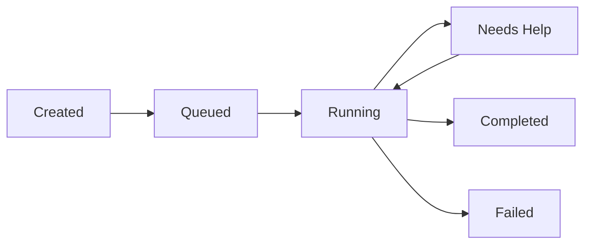

## 概述

Bytebot智能代理系统将简单的桌面容器转变为智能自主的计算机用户。通过将Claude AI与结构化任务管理相结合，它能理解自然语言请求并像人类一样执行复杂的工作流程。


## AI代理工作原理

### 大脑：多模型AI集成

Bytebot的核心是一个灵活的AI集成系统，支持多种模型。选择最适合您需求的AI：

**Anthropic Claude**（默认）：

- 最适合复杂推理和视觉理解
- 擅长遵循详细指令
- 在桌面自动化任务上表现卓越

**OpenAI GPT模型**：

- 快速可靠，适用于通用自动化
- 强大的代码理解和生成能力
- 对常规任务具有成本效益

**Google Gemini**：

- 高效处理大批量任务
- 速度与能力的良好平衡
- 出色的多语言支持

使用任何模型的代理都能：

1. **理解上下文**：结合完整对话历史处理您的自然语言请求
2. **规划行动**：将复杂任务分解为可执行的计算机操作
3. **实时适应**：根据屏幕显示内容调整执行方式
4. **从反馈中学习**：通过对话改进任务执行效果

### 对话流程

<Steps>
  <Step title="您描述任务">
    "为我的SaaS产品研究竞争对手并创建对比表格"
  </Step>
  <Step title="AI规划执行方案">
    AI模型理解请求并规划：打开浏览器→搜索→访问网站→提取数据→创建文档
  </Step>
  <Step title="执行操作">
    智能体控制桌面：点击、输入、截图、读取内容
  </Step>
  <Step title="提供进度更新">
    实时状态更新并在需要时请求澄清
  </Step>
  <Step title="交付结果">
    完成任务并提供输出（文件、截图、摘要）
  </Step>
</Steps>

## 任务管理系统

### 任务生命周期

任务按照结构化生命周期流转：



### 任务属性

每个任务包含：

- **描述**：需要完成的内容
- **优先级**：紧急、高、中或低
- **状态**：生命周期中的当前状态
- **类型**：立即执行或计划执行
- **历史记录**：所有已采取的消息和操作

### 智能任务处理

智能体智能处理任务：

1. **优先级队列**：紧急任务优先运行
2. **错误恢复**：自动重试失败的操作
3. **人工介入**：遇到困难时请求帮助
4. **上下文保持**：跨会话维护对话历史

## 实际能力

### 智能体能够执行的操作

<CardGroup cols={2}>
  <Card title="Web Automation" icon="globe">
    - 浏览网站
    - 填写表单
    - 提取数据
    - 下载文件
    - 监控变化
  </Card>
  <Card title="Document Work" icon="file">
    - 创建文档
    - 编辑电子表格
    - 生成报告
    - 整理文件
    - 转换格式
  </Card>
  <Card title="Email & Communication" icon="envelope">
    - 通过浏览器访问网页邮件
    - 读取和提取信息
    - 填写联系表单
    - 导航通信门户
    - 处理验证流程
  </Card>
  <Card title="Data Processing" icon="database">
    - 从PDF中提取数据
    - 处理CSV文件
    - 创建可视化图表
    - 生成摘要
    - 转换数据格式
  </Card>
</CardGroup>

## 技术架构

### 核心组件

1. **NestJS Agent Service**
   - 集成多个AI提供商API（Anthropic、OpenAI、Google）
   - 处理WebSocket连接
   - 与桌面API协调工作

2. **Message System**
   - 结构化对话格式
   - 支持文本和图像
   - 维护完整上下文
   - 实现丰富交互

3. **Database Schema**
   ```sql
   Tasks: id, description, status, priority, timestamps
   Messages: id, task_id, role, content, timestamps
   Summaries: id, task_id, content, parent_id
   ```

4. **Computer Action Bridge**
   - 将AI决策转换为桌面操作
   - 处理屏幕截图和反馈
   - 管理操作时机
   - 提供错误处理

### API 端点

程序化控制的关键端点：

```typescript
// Create a new task
POST /tasks
{
  "description": "Your task description",
  "priority": "HIGH",
  "type": "IMMEDIATE"
}

// Get task status
GET /tasks/:id

// Send a message
POST /tasks/:id/messages
{
  "content": "Additional instructions"
}

// Get task history
GET /tasks/:id/messages
```

## 聊天界面功能

网页界面提供：

### 实时交互

- 与AI代理实时聊天
- 即时状态更新
- 进度指示器
- 错误通知

### 视觉反馈

- 嵌入式桌面查看器
- 截图历史记录
- 操作回放
- 任务时间线

### 任务管理

- 创建和优先排序任务
- 查看活跃和已完成任务
- 导出对话日志
- 管理任务队列

## 安全与隐私

### 数据隔离

- 所有处理都在您的基础设施中进行
- 不向外部服务发送数据（除您选择的AI提供商API外）
- 对话本地存储
- 完整的审计追踪

### 访问控制

- 可配置的身份验证
- API密钥管理
- 网络隔离选项

## 扩展代理功能

### 集成点

- 通过Agent API进行外部API调用
- 为专业工作流程定制AI提示词
- 支持MCP协议实现工具集成

### 最佳实践

1. **明确指令**：具体说明期望结果
2. **分解复杂任务**：使用多个小型任务以获得更好效果
3. **提供上下文**：包含相关文件或URL
4. **监控进度**：通过桌面视图获取实时反馈
5. **审查结果**：验证输出是否符合要求

## 故障排除

<AccordionGroup>
  <Accordion title="代理无响应">
    - 检查 AI 供应商 API 密钥是否有效
    - 确认代理服务正在运行
    - 查看日志中的错误信息
    - 确保供应商处有足够的 API 额度/配额
  </Accordion>
  
  <Accordion title="任务执行缓慢">
    - 监控系统资源
    - 检查网络延迟
    - 降低截图频率
    - 针对所选模型优化 AI 提示
    - 考虑切换到更快的模型（例如 Gemini Flash）
  </Accordion>
</AccordionGroup>

## 后续步骤

<CardGroup cols={2}>
  <Card title="快速开始" icon="rocket" href="/quickstart">
    让您的代理运行起来
  </Card>
  <Card title="API 参考" icon="code" href="/api-reference/agent/tasks">
    与您的应用集成
  </Card>
  <Card title="使用案例" icon="lightbulb" href="#example-use-cases">
    了解可实现的功能
  </Card>
  <Card title="最佳实践" icon="star" href="#best-practices">
    优化您的工作流程
  </Card>
</CardGroup>