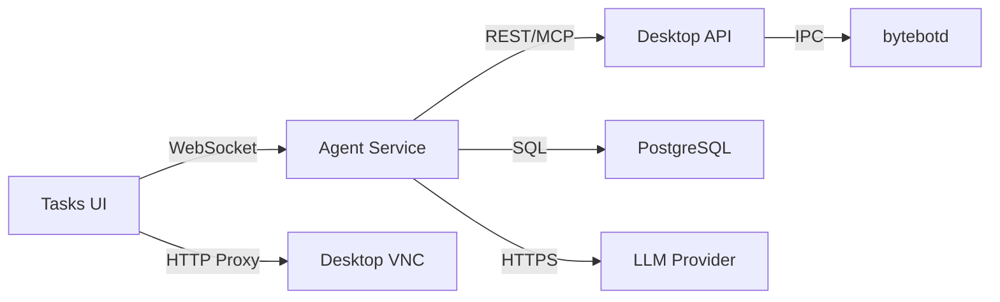

## 概述

Bytebot是一个采用模块化架构构建的自托管AI桌面代理。它结合了Linux桌面环境和人工智能，创建了一个能够通过自然语言指令执行任务的自主计算机用户。


## 系统架构

系统由四个主要组件协同工作：

### 1. Bytebot桌面容器

系统的基础 - 提供虚拟Linux桌面环境：

- **Ubuntu 22.04 LTS** 基础系统，确保稳定性和兼容性
- **XFCE4桌面** 提供轻量级、响应迅速的UI界面
- **bytebotd守护进程** - 基于nutjs构建的自动化服务，执行计算机操作
- **预装应用程序**：Firefox ESR、Thunderbird、文本编辑器和开发工具
- **noVNC** 用于远程桌面访问

**核心特性:**

- 与主机系统完全隔离运行
- 跨不同平台保持环境一致性
- 可安装额外软件进行自定义
- 通过端口9990的REST API访问
- MCP SSE端点位于 `/mcp`
- 使用 `@bytebot/shared` 包的共享类型

### 2. AI代理服务

系统的大脑 - 使用LLM编排任务：

- **NestJS Framework** 用于构建健壮、可扩展的后端
- **LLM Integration** 支持 Anthropic Claude、OpenAI GPT 和 Google Gemini 模型
- **WebSocket Support** 提供实时更新
- **Computer Use API Client** 用于控制桌面
- **Prisma ORM** 用于数据库操作
- **计算机操作工具定义**（鼠标、键盘、截图）

**职责：**

- 解析自然语言请求
- 规划计算机操作序列
- 管理任务状态和进度
- 处理错误和重试
- 通过 WebSocket 提供实时任务更新

### 3. Web 任务界面

与 AI 代理交互的用户界面：

- **Next.js 15 Application** 配合 TypeScript 确保类型安全
- **嵌入式 VNC Viewer** 用于观看桌面操作
- **任务管理** UI 带有状态徽章
- **WebSocket Connections** 提供实时更新
- **可复用组件** 确保一致的 UI
- **API 工具** 简化服务器通信

**功能特性:**

- 任务创建和管理界面
- 桌面选项卡用于直接手动控制
- 带接管模式的实时桌面查看器
- 任务历史和状态跟踪
- 响应式设计适配所有设备

### 4. PostgreSQL 数据库

代理系统的持久化存储：

- **Tasks Table**：存储任务详情、状态和元数据
- **Messages Table**：存储 AI 对话历史
- **Prisma ORM** 用于类型安全的数据库访问

## 数据流

### 任务执行流程

<Steps>
  <Step title="用户输入">
    用户通过聊天界面以自然语言描述任务
  </Step>
  <Step title="任务创建">
    Agent 服务创建任务记录并将其添加到处理队列
  </Step>
  <Step title="AI 规划">
    LLM 分析任务并生成计算机操作计划
  </Step>
  <Step title="操作执行">
    Agent 通过 REST API 或 MCP 将计算机操作发送至 bytebotd
  </Step>
  <Step title="桌面自动化">
    bytebotd 在桌面上执行操作（鼠标、键盘、截图）
  </Step>
  <Step title="结果处理">
    Agent 接收结果，更新任务状态，并继续或完成任务
  </Step>
  <Step title="用户反馈">
    结果和状态更新实时发送回用户
  </Step>
</Steps>

### 通信协议



## 安全架构

### 隔离层

1. **容器隔离**
   - 每个桌面运行在独立的 Docker 容器中
   - 默认无法访问主机文件系统
   - 通过显式端口映射实现网络隔离

2. **进程隔离**
   - bytebotd 以非 root 用户身份运行
   - 不同服务使用独立进程
   - 通过 Docker 强制执行资源限制

3. **网络安全**
   - 默认仅允许本地主机访问服务
   - 可配置身份验证
   - 外部连接使用 HTTPS/WSS

### API 安全

- **Desktop API**: 默认无需认证（仅限 localhost）。支持 REST 和 MCP。
- **Agent API**: 可通过 API 密钥进行安全保护
- **Database**: 密码保护，不对外暴露

<Warning>
  默认配置适用于开发环境。生产环境需：
  - 对所有 API 启用身份验证
  - 所有连接使用 HTTPS/WSS
  - 实施网络策略
  - 定期轮换凭据
</Warning>

## 部署模式

### 单用户（开发环境）

```yaml
Services: All on one machine
Scale: 1 instance each
Use Case: Personal automation, development
Resources: 4GB RAM, 2 CPU cores
```

### 生产环境部署

```yaml
Services: All services on dedicated hardware
Scale: Single instance (1 agent, 1 desktop)
Use Case: Business automation
Resources: 8GB+ RAM, 4+ CPU cores
```

### 企业级部署

```yaml
Services: Kubernetes orchestration
Scale: Single instance with high availability
Use Case: Organization-wide automation
Resources: Dedicated nodes
```

## 扩展点

### 自定义工具

向桌面添加专用软件：

```dockerfile
FROM bytebot/desktop:latest
RUN apt-get update && apt-get install -y \
    your-custom-tools
```

### AI 集成

扩展代理能力：

- 为 LLM 定制工具
- 附加 AI 模型
- 专用提示词
- 领域特定知识

## 性能注意事项

### 资源使用

- **桌面容器**: 空闲时约 1GB 内存，活跃时 2GB+
- **代理服务**: 约 256MB 内存
- **UI 服务**: 约 128MB 内存
- **数据库**: 约 256MB 内存

### 优化建议

1. 为容器分配充足资源
2. 限制并发任务以防过载
3. 定期监控资源使用情况
4. 使用 LiteLLM 代理实现供应商灵活性

## 后续步骤

<CardGroup cols={2}>
  <Card title="Agent System" icon="robot" href="/core-concepts/agent-system">
    了解AI智能体功能
  </Card>
  <Card title="Desktop Environment" icon="desktop" href="/core-concepts/desktop-environment">
    探索虚拟桌面环境
  </Card>
  <Card title="API Reference" icon="code" href="/api-reference/introduction">
    与您的应用程序集成
  </Card>
  <Card title="Deployment Guide" icon="rocket" href="/quickstart">
    部署您自己的实例
  </Card>
</CardGroup>