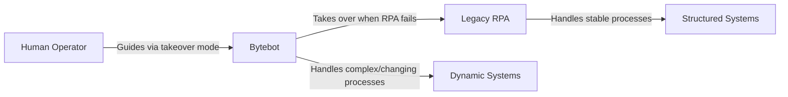

# 新一代企业自动化

Bytebot 代表了企业在流程自动化方法上的根本性转变。虽然像 UiPath、Automation Anywhere 和 Blue Prism 这样的传统 RPA 工具需要大量的脚本编写和脆弱的工作流程，但 Bytebot 利用人工智能来像人类一样理解和执行任务。

## 传统 RPA 的局限性

<CardGroup cols={2}>
  <Card title="脆弱的定位器" icon="xmark">
    当 UI 元素即使发生微小变化时，传统 RPA 就会失效
  </Card>
  <Card title="复杂的开发" icon="code">
    需要专门的开发人员和漫长的实施周期
  </Card>
  <Card title="高昂的维护成本" icon="wrench">
    随着应用程序的发展，需要不断更新
  </Card>
  <Card title="有限的适应性" icon="robot">
    无法处理意外情况或变化
  </Card>
</CardGroup>

## Bytebot 的不同之处

### 视觉智能 vs 元素映射

**传统 RPA:**

```xml
<!-- Brittle selector that breaks with any UI change -->
<Click>
  <Selector>
    <webctrl id='submit-btn-2947' 
             class='btn-primary-new' 
             idx='3'/>
  </Selector>
</Click>
```

**Bytebot:**

```
"Click the blue Submit button at the bottom of the form"
```

Bytebot 像人类一样通过视觉理解界面。它不依赖每次更新都会失效的脆弱技术定位器。

### 自然语言 vs 复杂脚本

**传统 RPA 工作流程:**

- 在 Studio 中设计
- 映射每个元素
- 编写错误处理脚本
- 全面测试
- 提心吊胆地部署
- 出现问题及时修复（经常发生）

**Bytebot 工作流程：**

- 描述您的需求
- Bytebot 智能解析
- 智能处理错误
- 自动适应变化

## 真实企业案例

### 金融服务自动化

<Tabs>
  <Tab title="传统 RPA">
    ```csharp
    // 500+ 行代码处理单个银行门户
    var loginPage = new LoginPageObject();
    loginPage.WaitForElement("username", 30);
    loginPage.EnterText("username", credentials.User);
    loginPage.EnterText("password", credentials.Pass);
    
    // 使用复杂条件逻辑处理双因素认证
    if (loginPage.Has2FAPrompt()) {
      var method = loginPage.Get2FAMethod();
      switch(method) {
        case "SMS":
          // 再写 50 行代码
        case "Email":
          // 再写 50 行代码
        case "Authenticator":
          // 再写 50 行代码
      }
    }
    
    // 使用精确选择器下载对账单
    navigation.ClickElement("xpath://div[@id='acct-menu']");
    navigation.ClickElement("xpath://a[contains(@href,'statements')]");
    // ... 继续数百行代码
    ```
  </Tab>
  <Tab title="Bytebot">
    ```
    任务: "登录大通银行门户，导航至对账单，
    下载账户尾号 4521 上个月的所有对账单，
    并将其保存至 Finance/BankStatements/Chase/"
    
    仅此而已。Bytebot 自动处理所有事项——包括双因素认证。
    ```
  </Tab>
</Tabs>

### 多系统集成

一家金融科技公司需要自动化操作人员的工作，这些操作人员：

1. 登录多个支持双因素认证的银行门户
2. 下载交易文件
3. 对这些文件运行专有脚本
4. 将结果上传至内部系统

**传统RPA面临的挑战：**

- 实施周期长达6个月
- 每月因UI变更而失效
- 需要专门的维护团队
- 无法处理新银行接入而无需开发
- 每家银行需单独处理复杂的双因素认证逻辑

**Bytebot解决方案：**

- 一周内完成部署
- 自动适应UI变更
- 通过密码管理器自动处理双因素认证
- 通过简单指令即可添加新银行
- 完全无需人工干预

## 性能对比

| 指标 | 传统RPA | Bytebot |
|--------|----------------|---------|
| **实施时间** | 3-6个月 | 1-2周 |
| **开发人员要求** | RPA专家 | 任何技术用户 |
| **维护工作量** | 占用40%开发时间 | 近乎为零 |
| **处理UI变更** | 立即失效 | 自动适应 |
| **错误恢复** | 仅支持预设脚本 | 智能适配 |
| **新增流程** | 需要数周开发 | 几分钟描述即可 |
| **成本** | 每年10万美元以上 | 自托管于您的基础设施 |

## 常见RPA迁移模式

### 1. 发票处理

**迁移前（UiPath）：**

- 2000多行工作流XML代码
- 供应商门户更新即导致系统中断
- 要求严格的文件夹结构
- 遇到意外弹窗即失败

**迁移后（Bytebot）：**

- 单段描述
- 处理门户变更
- 需要时请求帮助
- 智能处理变化

### 2. 合规报告

**之前（Automation Anywhere）：**

- 复杂的机器人编排
- 每个系统使用独立机器人
- 固定调度
- 缺乏灵活性

**之后（Bytebot）：**

- 单一统一工作流
- 自然语言指令
- 动态适应
- 需要时进行人工协作

### 3. 数据迁移

**之前（Blue Prism）：**

- 庞大的流程定义
- 需要精确字段映射
- 数据变化时中断
- 有限的错误处理

**之后（Bytebot）：**

- 描述映射规则
- 智能处理变化
- 请求澄清
- 包含可视化验证

## 与现有RPA集成

Bytebot可与现有RPA投资协同工作：



## 企业架构

### 部署选项

<CardGroup cols={2}>
  <Card title="本地部署" icon="server">
    在您的数据中心部署，实现最高安全性和合规性
  </Card>
  <Card title="私有云" icon="cloud">
    使用您的AWS/Azure/GCP基础设施，完全掌控
  </Card>
  <Card title="混合模式" icon="arrows-split-up-and-left">
    本地处理敏感数据，利用云端进行扩展
  </Card>
  <Card title="物理隔离" icon="shield">
    为机密环境提供完全隔离的部署方案
  </Card>
</CardGroup>

### 安全与合规

- **数据主权**: 所有处理都在您的基础设施上进行
- **审计追踪**: 完整记录每个操作日志
- **访问控制**: 与您的 IAM/SSO 集成
- **合规性**: 支持 SOC2、HIPAA、PCI-DSS 兼容部署

## 迁移入门指南

<Steps>
  <Step title="识别流程">
    列出您当前的 RPA 工作流，特别是：
    - 频繁中断的流程
    - 需要定期维护的流程
    - 处理多个系统的流程
    - 需要人工决策点的流程
  </Step>
  
  <Step title="从小处着手">
    选择一个有问题的流程：
    - 记录业务流程
    - 部署 Bytebot
    - 自然描述任务
    - 比较结果
  </Step>
  
  <Step title="逐步扩展">
    随着信心增长：
    - 迁移更复杂的流程
    - 淘汰脆弱的 RPA 机器人
    - 减少维护开销
    - 跨部门扩展
  </Step>
</Steps>

## 后续步骤

<CardGroup cols={2}>
  <Card title="快速开始" icon="rocket" href="/quickstart">
    在您的环境中部署 Bytebot
  </Card>
  <Card title="GitHub" icon="github" href="https://github.com/bytebot-ai/bytebot">
    查看源代码并参与贡献
  </Card>
  <Card title="社区" icon="users" href="https://discord.gg/zcb5wA2t4u">
    加入我们的 Discord 获取支持
  </Card>
  <Card title="企业支持" icon="users" href="https://discord.gg/zcb5wA2t4u">
    获取企业部署帮助
  </Card>
</CardGroup>

<Note>
  **准备好超越传统 RPA 了吗？** Bytebot 为流程自动化带来类人智能，消除传统工具的脆弱性和复杂性，同时提供企业级的可靠性和安全性。
</Note>